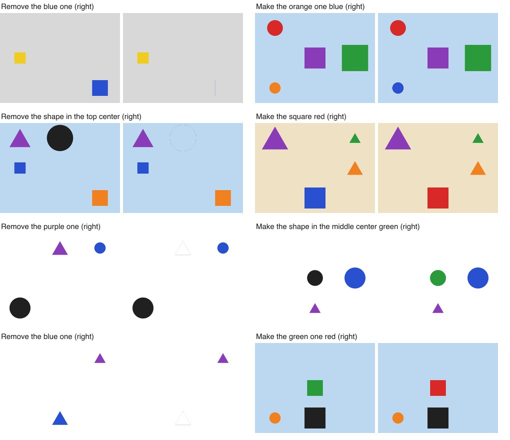

# iJev

Eyes for Jev. TypeSafe's Jev is a fast, text-only decision model: it can't take images. iJev turns an image into text with plain code (no vision models), a letter map of color segments with a legend and silhouettes, and Jev reads it, answers questions about it and acts on it.

On generated scenes of circles, squares and triangles, Jev answers 92% of questions right (shape 100%, position 100%, counts 87%) and carries out instructions like "Remove the triangle" or "Make the blue one yellow" on the right shape 97% of the time.



On real photos it can select large regions, like the sky for "Make the sky look like a sunset" (original, what Jev selected, result):


It can't yet find small objects in real photos; see the results below. The repo also keeps the earlier experiments that led here: drawing with shapes, whole-photo filters, local edits and object removal, some of which use Claude to describe photos (`--eyes claude`).

```sh
npm install
echo "TYPESAFE_API_KEY=..." > .env
npm run samples                                   # macOS wallpaper + damaged copies
node src/fetch-photos.ts 24                       # benchmark photos (Unsplash License, via picsum.photos)
node src/fetch-photos.ts 40 --page 3 --dir samples/calibration && node src/calibrate.ts

# Drawing
node src/draw-pixels.ts "a red heart on a white background" [--blind]
node src/draw-shapes.ts "a snowman" [--variants 4] [--no-feedback]
node src/bench-draw.ts --rounds 2                 # Claude scores the pictures blind

# Jev sees with no models: code turns the image into text (retina.ts), Jev reads it
node src/quiz.ts --scenes 30                      # questions about shape scenes, scored
node src/act.ts --scenes 60                       # "remove the triangle" etc., scored; examples in watch/

# Local edits: Jev decides where (one yes/no per region) and what; code does the pixels
node src/local-edit.ts samples/photos/75.jpg "Turn the grapes green"   # result in watch/
node src/remove.ts samples/photos/8.jpg "Remove the coffee cup"         # result in watch/

# Editing (whole-photo filters)
node src/edit.ts criteria/*.json                  # hand-written checks decide when to stop
node src/edit.ts samples/sonoma.jpg "Make it a dramatic black and white photo"   # Jev sets its own targets
node src/bench-edit.ts                            # 24 damaged photos, every mode
```

The photo describer and the drawing judge (`src/see.ts`) run the `claude` CLI
headless on a Claude Code login. Output goes to `out/`, photos to `samples/`
(both git-ignored).

## How it works

- **Pixels** (`draw-pixels.ts`): a 16x16 grid, one request per row, one color question per pixel.
- **Shapes** (`draw-shapes.ts`): Jev picks the next element, then its shape, color, place ("on top of the house wall") and size. A small layout engine turns the words into coordinates. With feedback, code describes each element as drawn ("18% of the canvas wide, 2.5 times taller than wide, covers 10% of the sun") and Jev may adjust it. With `--variants`, choices are sampled from Jev's top 3 and Jev picks the best picture from the descriptions.
- **Editing** (`editor.ts`): code describes the photo (brightness, contrast, saturation, warmth, clipping, a 5x5 grid of color names, each compared with real photos from `calibration.json`). Jev picks one of 11 edits and a strength. Who decides when to stop:
  - `jev`: Jev itself.
  - `checks`: ranges from a criteria file, which Jev never sees.
  - `targets`: Jev first decides whether the photo needs editing, then picks "keep" or a level for each number; code turns those into ranges.
  - `oracle`: ranges around the undamaged original (the best this edit set can do).
  - `+seen`: Claude looks at the photo once and describes the scene, style and what looks off. It never suggests edits.

  In every mode except `jev`, code keeps an edit only if it gets closer to the ranges; otherwise it tries a smaller step, then Jev's next choice.

## Results (10 Oct 2026, jev-1.13)

### Style goals (criteria/*.json, one wallpaper)

All four pass with hand-written checks, and code never had to override Jev's choice. In targets mode, Jev's own targets made sense ("dark and moody, dramatic, no color" for dramatic B&W; "very warm" for golden hour). Dramatic B&W got stuck there because those targets plus a clipping limit can't all hold on that photo.

### "Fix this photo so it looks natural" (24 photos, 9 kinds of damage, 3 rounds)

Distance to the undamaged original, 0-255; leaving the photo alone scores 18.7.

| mode | after | better | worse |
| --- | --- | --- | --- |
| jev | 19.0-20.5 | 11-13 of 24 | 9-10 |
| targets | 21.4-22.2 | 13 | 10 |
| jev+seen | 22.6-23.7 | 6-7 | 10-11 |
| targets+seen | 20.6-21.4 | 4-6 | 7 |
| oracle | 10.8-11.8 | 17 | 0 |

No Jev mode beats leaving the photo alone. The oracle shows the edits are good enough; the missing piece is knowing what each photo *should* look like. Seeing helps Jev do less harm (undamaged photos 24 -> 4-11, fewest photos made worse), but it also reads a darkened photo as "moody, intentional" and leaves it.

### Drawing (6 subjects x 2 rounds, Claude scores blind, 1-10)

| picture | score |
| --- | --- |
| first version | 3.6-3.9 |
| after fixes, no feedback | 4.0-4.3 |
| after fixes, with feedback | 4.1-4.5 |
| random one of 4 versions | 2.8-3.4 |
| Jev's pick of 4 | 4.3-4.4 |
| Claude's favorite of 4 | 4.4-5.3 |

Claude's scores for the same images move by about 0.3 between runs, so only the bigger gaps mean much. Picking among options is Jev's strength: its pick beats a random version by about 1 point.

### Local edits (`local-edit.ts`, 10 Oct 2026)

The photo is cut into ~350 regions that follow its edges (SLIC, `regions.ts`). Claude looks once and lists the main things with color and place; Jev answers one yes/no question per region ("does this region show the thing the instruction is about?"), plus the operation, color and strength. Code smooths the answers with neighbors, cuts where they split into yes and no, and edits only inside that mask. About 10 Jev requests per edit.

Without Claude's list, Jev picked the green leaves for "turn the grapes green" (it matched the word, and "dark gray, textured" doesn't say grape). With it, grapes scored about 0.72 and everything else about 0.3. Works on grapes, sky, wooden table, a car; weak where two things share a color (black laptop screen vs black background, calm sea vs sky).

### Removing objects (`remove.ts`, 10 Oct 2026)

Claude lists the things in the photo with rough boxes. Jev classifies each of ~700 regions as one of the things whose box holds it, then decides which things go ("the cup, and its saucer and spoon") and which continue behind them ("the wooden table"). Code fills the hole from the outside in, copying 9x9 patches only from what Jev said continues behind. Coffee cup on the wooden desk: clean. Phone on a book page: removed, but the fill copied bits of nearby logos. Small cup on a dark table: Jev found only part of the saucer. Small, busy objects are where words stop being enough ("light cyan, white" doesn't read as a phone screen).

### Jev sees, no models (`retina.ts`, `quiz.ts`, `act.ts`, 10 Oct 2026)

Plain code turns the image into text: SLIC patches merged into 12-36 segments of similar color, a grid of letters (one per segment) as the map, and a legend per letter with color and rgb, size, position, what it borders or sits inside, and a # and . silhouette.

Quiz, 30 generated scenes of circles, squares and triangles:

| question | chance | raw color grid | segments | segments + silhouettes |
| --- | --- | --- | --- | --- |
| what color is the circle | 14% | 45% | 77% | 86% |
| what shape is the blue one | 33% | 47% | 37% | 100% |
| where is it | 11% | 87% | 100% | 100% |
| how many triangles | 20% | 27% | 30% | 87% |
| which color is biggest | 14% | 67% | 87% | 83% |
| all | | 55% | 65% | 92% |

Counting works per segment ("what is B?") with code adding up; "biggest" works as "which segment?" then "what color is it?". Asked in one go, both were near chance.

Acting on it, 60 scenes ("Remove the triangle", "Make the blue one yellow", "Remove the shape in the top right"): Jev picks the right shape 97% of the time (58/60) and the right new color 30/30.

Real photos with only code eyes: Jev selects the sky exactly for "make the sky a sunset", but it can't find small objects (cup, phone, license plate: locating them is near chance) and picked the background for "the grapes". Code-made text carries shape, color and layout; it doesn't carry what a cup looks like.

## Lessons

- Jev is only as good as the text it gets. Labels tuned on one vivid wallpaper called most real photos "dull" (their median saturation is 0.12, not 0.4) and Jev saturated everything. Calibrating on a separate photo set fixed that.
- Test on more than one photo. On the wallpaper everything looked solved; on 24 photos no mode beat doing nothing.
- Edits must be independent. A per-channel contrast also warmed photos, contrast around mid-gray darkened dark photos, and a multiplicative "darker" lowered contrast. Each made good choices fail.
- Stopping belongs to code, like jevvium's `expect`. When the checks passed, Jev still wanted another edit, with goal_met 0.21-0.46.
- Offer "leave it" as its own decision. As one option among many it almost never wins ("looks right" for drawings, "keep" for targets); a yes-or-no question first works better.
- Many drawing failures were mine: no canvas color in the prompt (white snowman on white), no "lower-left part of" (one-wheel car), sampling from all options (junk variants), compounding relative sizes (tiny flowers).
- Freeze inputs before comparing runs. Rewriting the damaged files threw away cached descriptions, and the new ones moved the results as much as the changes being tested.

## Credits

Benchmark photos are fetched at runtime from [picsum.photos](https://picsum.photos) (Unsplash License) and not stored here. The sky example in `docs/` is by [Paul Jarvis on Unsplash](https://unsplash.com/photos/gkT4FfgHO5o). Jev is [TypeSafe](https://typesafe.ai)'s model; you need your own key.

## License

MIT
